# github-readme-stats-plus

Repository pin cards for your GitHub profile README, in 26 styles. You host it yourself, for yourself: one small Vercel function with no dependencies.

<p>
  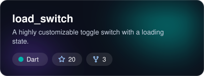
  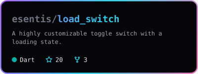
</p>

## Styles

Pick one with `&style=<name>`. The default is `adaptive`.

| Style | Preview | Notes |
| --- | --- | --- |
| `adaptive` |  | Light or dark, following the viewer's system theme. A safe default. |
| `aurora` |  | Slowly drifting blurred glow in the repo's language colour. |
| `neon` |  | Monospace, with a rotating gradient border. |
| `spotlight` |  | The star count is the hero, over a pulsing glow. |
| `brutalist` | 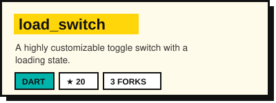 | Cream card, thick outline, hard shadow, highlighter title. |
| `glass` | 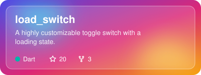 | Frosted panel over a colourful gradient. |
| `terminal` | 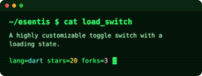 | Green phosphor terminal with scanlines and a blinking cursor. |
| `bold` | 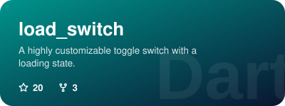 | Full gradient in the language colour, with the language as a watermark. |
| `holo` |  | Iridescent foil with a shine sweeping across, like a rare trading card. |
| `blueprint` | 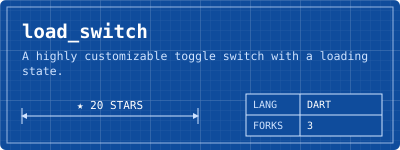 | Technical drawing: stars as a dimension line, language and forks in a title block. |
| `synthwave` | 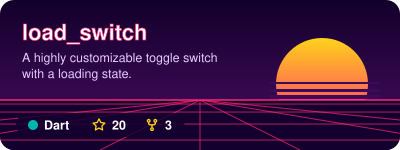 | 80s sunset with a striped sun over a scrolling neon grid. |
| `pixel` | 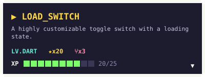 | 8-bit dialog box. The XP bar fills toward the next star milestone (10, 25, 50, 100…). |
| `swiss` | 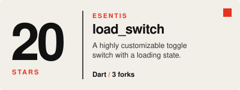 | Light editorial poster with a huge star count and one red accent. |
| `boarding` | 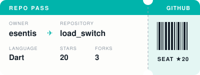 | A ticket with a tear-off stub and a barcode unique to each repo. Shows no description. |

### Everyday objects

| Style | Preview | Notes |
| --- | --- | --- |
| `periodic` | 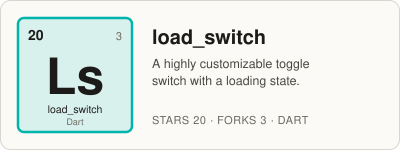 | An element tile: stars as the atomic number, a symbol made from the name. |
| `creditcard` | 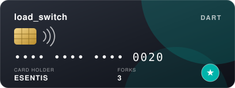 | A dark payment card. The star count is the card number. Shows no description. |
| `passport` | 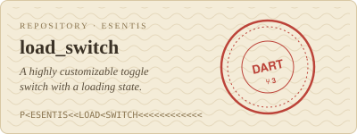 | A passport page with a machine-readable line and a red entry stamp. |
| `luggage` | 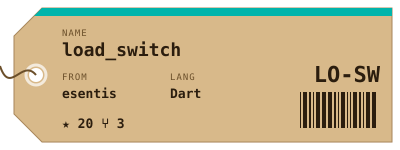 | Kraft-paper tag with a string, an airport-style code and a barcode. Shows no description. |
| `cinema` | 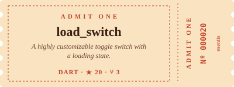 | Vintage "admit one" ticket with notched edges and a numbered stub. |
| `cassette` | 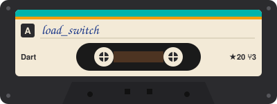 | Cassette tape with a hand-written label and spinning reels. Shows no description. |
| `floppy` | 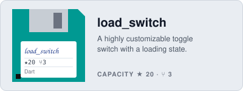 | A floppy disk in the language colour, with the repo on its label. |
| `vhs` | 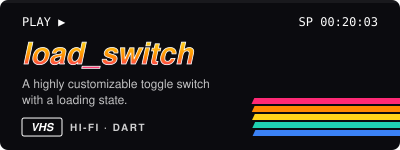 | VHS cover with a chrome title, rainbow stripes and a stars:forks timecode. |
| `handheld` | 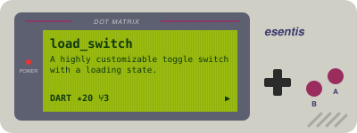 | 90s handheld console with a green dot-matrix screen. |
| `retrowin` |  | A mid-90s dialog box on a teal desktop. |
| `retromac` |  | A black-and-white early-90s window over a dithered desktop. |
| `splitflap` | 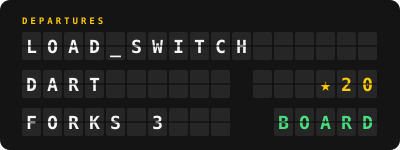 | An airport departures board. Shows no description. |

Most styles take their accent from the repository's main language colour, as GitHub shows it.

## Usage

Once your copy is deployed (see below), add cards to your profile README:

```html
<a href="https://github.com/esentis/load_switch">
  
</a>
```

For a grid, put several `<a></a>` blocks inside `<p align="center">` and give each image the same width, for example `width="278"` for three per row.

| Parameter | Required | Description |
| --- | --- | --- |
| `username` | yes | Owner of the repository. Must be listed in `ALLOWED_USERS`. |
| `repo` | yes | Repository name. |
| `style` | no | One of the styles above. Defaults to `adaptive`. |

If something goes wrong (a typo in the repo name, an unknown style, a user who isn't allowed), the card itself shows the reason instead of a broken image.

## Deploy your own

This project is meant to be forked: everyone runs their own copy with their own GitHub token, so nobody depends on someone else's server or API quota.

### 1. Create a GitHub token

Go to [github.com/settings/tokens/new](https://github.com/settings/tokens/new), give it a name, pick an expiry and **don't tick any scopes**. Cards only need public data. Private repositories are never rendered, even with a token that could see them.

### 2. Deploy to Vercel

The quickest way is the button. It forks the repo into your account and asks for the two environment variables:

[](https://vercel.com/new/clone?repository-url=https%3A%2F%2Fgithub.com%2Fesentis%2Fgithub-readme-stats-plus&env=GITHUB_TOKEN,ALLOWED_USERS&envDescription=GITHUB_TOKEN%3A%20a%20GitHub%20token%20with%20no%20scopes.%20ALLOWED_USERS%3A%20your%20GitHub%20username.)

Or fork the repo, clone it, and use the CLI:

```bash
npx vercel link
npx vercel env add GITHUB_TOKEN production
npx vercel env add ALLOWED_USERS production
npx vercel --prod
```

### Environment variables

| Variable | Required | Description |
| --- | --- | --- |
| `GITHUB_TOKEN` | yes | GitHub token with no scopes. |
| `ALLOWED_USERS` | yes | Comma-separated GitHub usernames whose repos this deployment will render, for example `esentis` or `esentis,a-friend`. Every other username gets an error card, so strangers can't use up your API quota. |

After changing a variable, redeploy for it to take effect.

## How it works

- `api/pin.js` checks the request, fetches the repo through GitHub's GraphQL API and returns an SVG.
- Cards are cached on Vercel's CDN for a day, so each card costs about one API call per day however often it's viewed. A no-scope token allows 5,000 points an hour, which is plenty for a personal profile.
- Text is never measured by a real font engine. Widths are estimated from character counts, and long names and descriptions are truncated with "…".

### Good to know

- **`adaptive` follows the viewer's operating system theme**, not their GitHub theme setting. Someone with a dark OS who chose GitHub's light theme sees a dark card.
- **The animations** (aurora, neon, spotlight, glass, terminal, holo, synthwave, pixel, cassette, vhs, handheld, splitflap) are plain SVG animations. They play in browsers, but GitHub may cache images for a while, and some email or RSS readers show a still frame.
- **Fonts** come from the viewer's system. `brutalist` looks best where Arial Black is installed (macOS and Windows) and falls back to bold Arial elsewhere.

## Add your own style

1. Create `styles/<name>.js` that exports a function taking the repo data and returning an SVG string. Copy the closest existing style as a starting point.
2. Register it in `styles/index.js`.
3. Run `npm run gallery` to regenerate the previews in `examples/`, and `npm test`. The tests check every registered style escapes its text and truncates long names.

The repo object a style receives:

```js
{
  owner: "esentis",
  name: "load_switch",
  description: "A highly customizable toggle switch with a loading state.",
  stars: "20",   // already formatted: "1.2K", "3.4M"
  starCount: 20, // the raw number, for anything that needs maths
  forks: "3",
  lang: { name: "Dart", color: "#00B4AB" },
}
```

`card.js` has the shared helpers: `svg()` for the frame, `esc()` for escaping, `fit()` and `wrap()` for truncating text, and `stats()` with `row()` for the language, star and fork line. Always pass repo text through `esc()`: names and descriptions come from strangers' repositories.

## Development

Needs Node 18 or newer. There's nothing to install.

```bash
npm test
```

```bash
npm run gallery
```

To preview a live card locally, run `npx vercel dev` with `GITHUB_TOKEN` and `ALLOWED_USERS` set, then open `http://localhost:3000/api/pin?username=YOU&repo=REPO&style=aurora`.

## Credits

Inspired by [anuraghazra/github-readme-stats](https://github.com/anuraghazra/github-readme-stats). The star and fork icons are [GitHub Octicons](https://github.com/primer/octicons) (MIT).

## License

[MIT](LICENSE)
