# Styles

All 169 styles, rendered with sample data. Pick one with `&style=<name>`. The default is `adaptive`.

<!-- Generated by `npm run gallery` from the style files. Edit those, not this page. -->

## Originals

<table>
<tr><td width="50%" valign="top"> <code>adaptive</code> Light or dark, following the viewer's system theme. The default.</td><td width="50%" valign="top">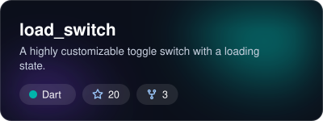 <code>aurora</code> Slowly drifting blurred glow in the repo's language colour.</td></tr>
<tr><td width="50%" valign="top">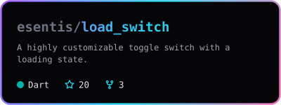 <code>neon</code> Monospace, with a rotating gradient border.</td><td width="50%" valign="top"> <code>spotlight</code> The star count is the hero, over a pulsing glow.</td></tr>
<tr><td width="50%" valign="top">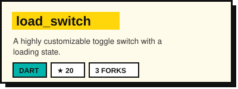 <code>brutalist</code> Cream card, thick outline, hard shadow and a highlighter title.</td><td width="50%" valign="top">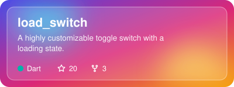 <code>glass</code> Frosted panel over a colourful gradient.</td></tr>
<tr><td width="50%" valign="top">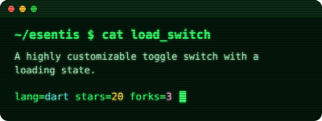 <code>terminal</code> Green phosphor terminal with scanlines and a blinking cursor.</td><td width="50%" valign="top">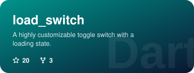 <code>bold</code> Full gradient in the language colour, with the language as a watermark.</td></tr>
<tr><td width="50%" valign="top"> <code>holo</code> Iridescent foil with a shine sweeping across, like a rare trading card.</td><td width="50%" valign="top">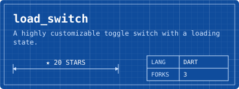 <code>blueprint</code> Technical drawing: stars as a dimension line, language and forks in a title block.</td></tr>
<tr><td width="50%" valign="top">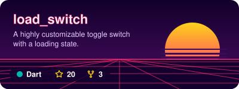 <code>synthwave</code> 80s sunset with a striped sun over a scrolling neon grid.</td><td width="50%" valign="top">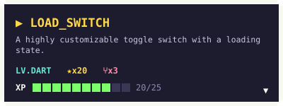 <code>pixel</code> 8-bit dialog box. The XP bar fills toward the next star milestone.</td></tr>
<tr><td width="50%" valign="top">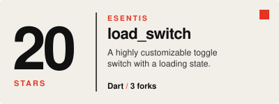 <code>swiss</code> Light editorial poster with a huge star count and one red accent.</td><td width="50%" valign="top">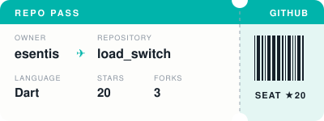 <code>boarding</code> Boarding pass with a tear-off stub and a barcode unique to each repo. Shows no description.</td></tr>
</table>

## Everyday objects

<table>
<tr><td width="50%" valign="top">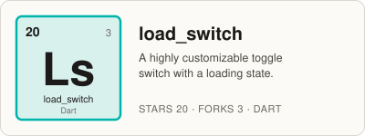 <code>periodic</code> Element tile: stars as the atomic number, a symbol made from the name.</td><td width="50%" valign="top">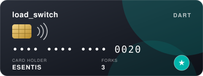 <code>creditcard</code> Dark payment card. The star count is the card number. Shows no description.</td></tr>
<tr><td width="50%" valign="top">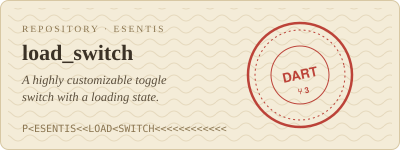 <code>passport</code> Passport page with a machine-readable line and a red entry stamp.</td><td width="50%" valign="top">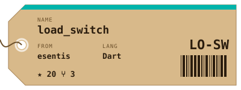 <code>luggage</code> Kraft-paper luggage tag with a string, an airport-style code and a barcode. Shows no description.</td></tr>
<tr><td width="50%" valign="top">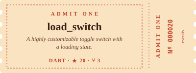 <code>cinema</code> Vintage "admit one" ticket with notched edges and a numbered stub.</td><td width="50%" valign="top">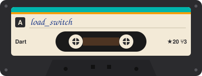 <code>cassette</code> Cassette tape with a hand-written label and spinning reels. Shows no description.</td></tr>
<tr><td width="50%" valign="top">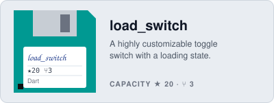 <code>floppy</code> Floppy disk in the language colour, with the repo on its label.</td><td width="50%" valign="top">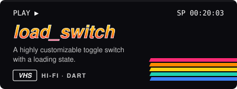 <code>vhs</code> VHS cover with a chrome title, rainbow stripes and a stars:forks timecode.</td></tr>
<tr><td width="50%" valign="top">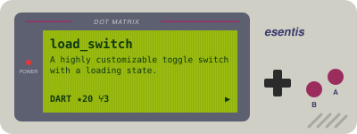 <code>handheld</code> 90s handheld console with a green dot-matrix screen.</td><td width="50%" valign="top"> <code>retrowin</code> Mid-90s dialog box on a teal desktop.</td></tr>
<tr><td width="50%" valign="top"> <code>retromac</code> Black-and-white early-90s window over a dithered desktop.</td><td width="50%" valign="top">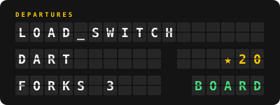 <code>splitflap</code> Airport split-flap departures board. Shows no description.</td></tr>
</table>

## Places and print

<table>
<tr><td width="50%" valign="top">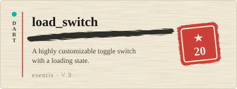 <code>washi</code> Washi paper and sumi ink: a brush stroke, a vertical language label and a red hanko seal with the star count.</td><td width="50%" valign="top"> <code>cyberpunk</code> Cyberpunk HUD: cut corners, yellow and cyan on near-black, data readouts and a sweeping scan line.</td></tr>
<tr><td width="50%" valign="top">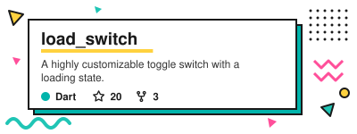 <code>memphis</code> Memphis 80s: squiggles, confetti triangles, dots and zigzags around a hard-shadow panel.</td><td width="50%" valign="top">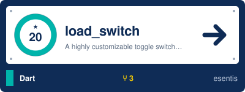 <code>railway</code> Railway station sign: a platform roundel with the star count, the name and a direction arrow.</td></tr>
<tr><td width="50%" valign="top">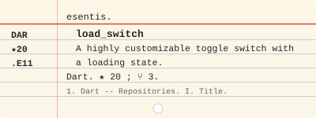 <code>catalog</code> Vintage library catalog card: ruled lines, a red heading line, a call number and typewriter text.</td><td width="50%" valign="top">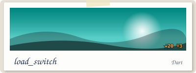 <code>polaroid</code> Instant photo: a sunset scene in the language colour and a hand-written caption. Shows no description.</td></tr>
<tr><td width="50%" valign="top">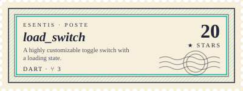 <code>stamp</code> Postage stamp: perforated edge, engraved frame, the star count as the denomination and a postmark.</td><td width="50%" valign="top"> <code>arcade</code> Arcade cabinet marquee: chrome trim, a backlit glow in the language colour and the stars as credits. Shows no description.</td></tr>
<tr><td width="50%" valign="top">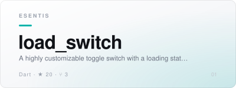 <code>keynote</code> Minimal presentation slide: lots of whitespace, one bold line and tiny metadata.</td><td width="50%" valign="top">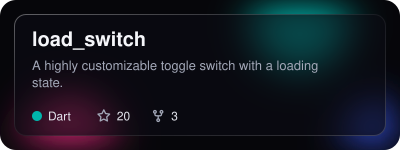 <code>darkglass</code> Dark glassmorphism: vivid blurred orbs behind a smoky translucent panel with a hairline border.</td></tr>
<tr><td width="50%" valign="top">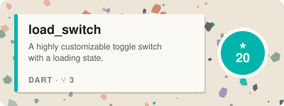 <code>terrazzo</code> Terrazzo: speckled stone chips unique to each repo, a solid label panel and a round star chip.</td><td width="50%" valign="top">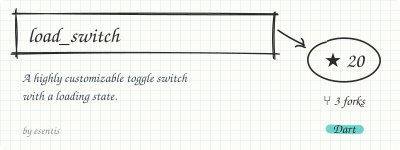 <code>sketch</code> Sketchbook doodle on graph paper: a wobbly hand-drawn box, an arrow to a circled star count, handwriting.</td></tr>
</table>

## Pop culture

<table>
<tr><td width="50%" valign="top">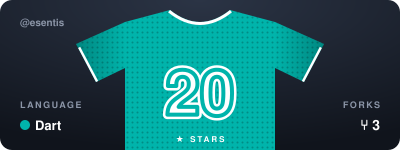 <code>jersey</code> Sports jersey in the language colour: repo name across the shoulders, star count as a stitched number. Shows no description.</td><td width="50%" valign="top">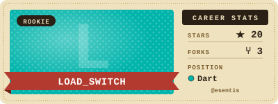 <code>tradingcard</code> Vintage baseball trading card: cream border, name on a ribbon banner, stat box with the language as the position. Shows no description.</td></tr>
<tr><td width="50%" valign="top">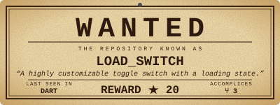 <code>wanted</code> Western wanted poster on aged paper: slab-serif WANTED, the repo name, its crime as the description and a star reward.</td><td width="50%" valign="top">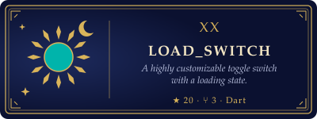 <code>tarot</code> Tarot card on its side: deep navy, thin gold frame, a sun in the language colour and the star count in roman numerals.</td></tr>
<tr><td width="50%" valign="top">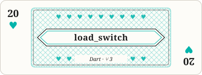 <code>playingcard</code> Playing card: star count as the rank with a suit in the language colour, ornate centre band with the repo name. Shows no description.</td><td width="50%" valign="top">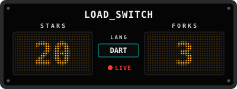 <code>scoreboard</code> Stadium LED scoreboard: amber dot-matrix STARS and FORKS scores under the repo name as the team. Shows no description.</td></tr>
<tr><td width="50%" valign="top">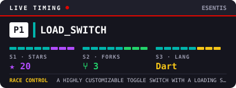 <code>racetiming</code> Motorsport live-timing screen: the repo on P1, purple/green/yellow sector times for stars, forks and language, race-control line with the description.</td><td width="50%" valign="top"> <code>ticker</code> Stock-ticker terminal: repo as a ticker symbol, green ▲ star count, sparkline, and a scrolling tape with the description.</td></tr>
<tr><td width="50%" valign="top">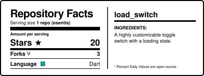 <code>nutrition</code> Black-and-white nutrition-facts label: Repository Facts with stars, forks and language rows, the description as the ingredients.</td><td width="50%" valign="top">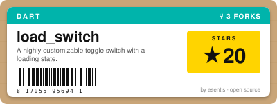 <code>productlabel</code> Retail product sticker on kraft card: big name, small-print description, barcode and a ★ price tag.</td></tr>
<tr><td width="50%" valign="top"> <code>wristband</code> Festival wristband: woven fabric strip in the language colour with the repo name, a plastic clasp and a passing sheen. Shows no description.</td><td width="50%" valign="top">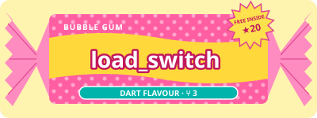 <code>gumwrapper</code> Bubble-gum wrapper: pink polka-dot wrapper with twisted ends, bubbly repo name and a pulsing FREE INSIDE burst with the star count. Shows no description.</td></tr>
</table>

## Art movements

<table>
<tr><td width="50%" valign="top"> <code>artdeco</code> Art deco: black lacquer and gold, stepped frame, a sunburst fan holding the star count, condensed caps.</td><td width="50%" valign="top"> <code>nouveau</code> Art nouveau: cream paper, sage whiplash curves and flowers in the language colour, elegant serif.</td></tr>
<tr><td width="50%" valign="top"> <code>destijl</code> De Stijl grid: thick black lines, red, yellow and blue blocks, one block in the language colour.</td><td width="50%" valign="top"> <code>constructivist</code> Constructivist poster: cream, red and black diagonals, a big red circle with the stars, bold slanted caps.</td></tr>
<tr><td width="50%" valign="top"> <code>popart</code> Pop art comic panel: yellow with red halftone dots, bold black outlines and a speech burst with the star count.</td><td width="50%" valign="top"> <code>ukiyoe</code> Japanese woodblock print: beige paper, curling indigo waves that roll gently, a red seal with the star count.</td></tr>
<tr><td width="50%" valign="top"> <code>meander</code> Greek classical: white marble with soft veins, Greek key bands top and bottom, serif capitals.</td><td width="50%" valign="top"> <code>blackletter</code> Gothic manuscript: parchment in a dark frame, an illuminated drop cap in the language colour, blackletter heading.</td></tr>
<tr><td width="50%" valign="top"> <code>apothecary</code> Victorian apothecary label: cream paper, double border with cut-in corners, a ribbon banner in the language colour, "No." star count.</td><td width="50%" valign="top"> <code>papelpicado</code> Papel picado: a string of swaying cut-paper flags with punched-out patterns, one in the language colour, on a night-plum wall.</td></tr>
<tr><td width="50%" valign="top"> <code>scandi</code> Scandinavian minimal: warm off-white, a few muted pastel shapes, lots of space and thin type.</td><td width="50%" valign="top"> <code>brutalweb</code> Brutalist web page: default serif on acid green, a blue underlined link, an h1 name, an hr and a bordered table.</td></tr>
</table>

## Digital art

<table>
<tr><td width="50%" valign="top"> <code>chrome</code> Liquid chrome blobs with sharp highlights on black, and a chrome title.</td><td width="50%" valign="top"> <code>pastel</code> Soft peach, lilac and mint gradient with rounded pills.</td></tr>
<tr><td width="50%" valign="top"> <code>duotone</code> Two-colour print: the language colour, near-black ink and big halftone shapes.</td><td width="50%" valign="top"> <code>glitch</code> RGB-split glitch title with displaced scanline slices that jitter now and then.</td></tr>
<tr><td width="50%" valign="top"> <code>ascii</code> ASCII art: a +-| box, a shadowed mono title and stats as plain text.</td><td width="50%" valign="top"> <code>wireframe</code> Neon wireframe cube turning slowly over a perspective grid floor.</td></tr>
<tr><td width="50%" valign="top"> <code>lowpoly</code> Low-poly mosaic in shades of the language colour, seeded by the repo name.</td><td width="50%" valign="top"> <code>voxel</code> Isometric voxel blocks: the stars stacked as a cube tower in the language colour.</td></tr>
<tr><td width="50%" valign="top"> <code>acrylic</code> Thick frosted acrylic slab with a bevelled edge, lit from behind in the language colour.</td><td width="50%" valign="top"> <code>bento</code> Bento grid of rounded tiles: name, a big star count, forks, language and description.</td></tr>
<tr><td width="50%" valign="top"> <code>dashboard</code> Dark analytics dashboard: KPI tiles and a decorative sparkline unique to each repo, drawing itself in.</td></tr>
</table>

## Signs and screens

<table>
<tr><td width="50%" valign="top"> <code>patch</code> Embroidered patch: satin-stitched border in the language colour, twill fabric and thread lettering.</td><td width="50%" valign="top"> <code>neonsign</code> Neon sign on a dark brick wall: glowing tube lettering in the language colour on metal standoffs, with an occasional flicker. Shows no description.</td></tr>
<tr><td width="50%" valign="top"> <code>chalkboard</code> Chalkboard: dark green slate with smudges, chalk-grain lettering, a doodled star and chalk on the tray.</td><td width="50%" valign="top"> <code>receipt</code> Thermal receipt: torn zig-zag edge, mono line items for stars, forks and language, a highlighted total and a barcode.</td></tr>
<tr><td width="50%" valign="top"> <code>vinyl</code> Vinyl record: a sleeve in the language colour with the record sliding out and its label slowly spinning.</td><td width="50%" valign="top"> <code>cartridge</code> Retro game cartridge: grey shell with grip ridges, a sunset label in the language colour and the name on a bold banner. Shows no description.</td></tr>
<tr><td width="50%" valign="top"> <code>placard</code> Museum placard: off-white card, small-caps owner, serif title, italic description and an accession line with stars and forks.</td><td width="50%" valign="top"> <code>subway</code> Transit map: one line in the language colour with stations for the owner, language, stars and forks.</td></tr>
<tr><td width="50%" valign="top"> <code>weather</code> Weather widget: soft sky gradient, stars as the big temperature, the language as the condition and a small forecast row.</td><td width="50%" valign="top"> <code>smartwatch</code> Smartwatch face: activity rings fill with stars and forks toward the next milestone, details beside the watch.</td></tr>
<tr><td width="50%" valign="top"> <code>bigtype</code> Kinetic type: the repo name oversized, cropped and repeated in sliding rows, with tiny stats. Shows no description.</td><td width="50%" valign="top"> <code>mesh</code> Gradient mesh: big soft organic blobs in the language colour and its hue-shifted complements behind a clean white label.</td></tr>
</table>

## Nature

<table>
<tr><td width="50%" valign="top"> <code>underwater</code> Deep-water gradient with swaying light rays and rising bubbles.</td><td width="50%" valign="top"> <code>starfield</code> Deep space with twinkling stars and a ringed planet in the language colour.</td></tr>
<tr><td width="50%" valign="top"> <code>topographic</code> Contour-line map with haloed map-label typography and a starred summit.</td><td width="50%" valign="top"> <code>borealis</code> Northern lights curtains over a dark mountain ridge under the stars.</td></tr>
<tr><td width="50%" valign="top"> <code>waves</code> Morning sea: rolling wave bands, a rising sun and a sailboat in the language colour.</td><td width="50%" valign="top"> <code>dunes</code> Warm desert dunes under a hazy shimmering sun.</td></tr>
<tr><td width="50%" valign="top"> <code>forest</code> Misty layered pine forest fading into the distance.</td><td width="50%" valign="top"> <code>lava</code> Cracked dark basalt with softly pulsing glowing lava veins.</td></tr>
<tr><td width="50%" valign="top"> <code>frost</code> Icy frosted glass with slowly turning snowflake crystals.</td><td width="50%" valign="top"> <code>sakura</code> Soft pink cherry blossom branch with petals drifting down.</td></tr>
<tr><td width="50%" valign="top"> <code>storm</code> Dark storm clouds, steady rain and an occasional lightning flash.</td><td width="50%" valign="top"> <code>moon</code> Night sky with a row of moon phases; more stars make the moon fuller.</td></tr>
</table>

## Materials and techniques

<table>
<tr><td width="50%" valign="top"> <code>clay</code> Claymorphism: puffy pastel shapes with soft shadows, inner highlights and a squishy blob in the language colour.</td><td width="50%" valign="top"> <code>riso</code> Risograph print: fluorescent pink and blue inks overprinting slightly out of register, with paper grain.</td></tr>
<tr><td width="50%" valign="top"> <code>isometric</code> Isometric 3D: a thick light slab with depth faces and a small staircase of blocks in the language colour.</td><td width="50%" valign="top"> <code>sticker</code> Die-cut vinyl sticker in the language colour: thick white border, a slight tilt and a peeling corner.</td></tr>
<tr><td width="50%" valign="top"> <code>neumorph</code> Neumorphism: one soft grey surface with extruded and pressed-in shapes and pill-shaped stat chips.</td><td width="50%" valign="top"> <code>origami</code> Folded paper: a creased sheet and a slowly turning paper pinwheel faceted in shades of the language colour.</td></tr>
<tr><td width="50%" valign="top"> <code>vaporwave</code> Vaporwave: pastel pink and cyan sky, a checkerboard floor, a marble column and a chromatic serif title.</td><td width="50%" valign="top"> <code>bauhaus</code> Bauhaus poster: cream paper, a primary-colour composition of circles, half-circles and squares, lowercase geometric type.</td></tr>
<tr><td width="50%" valign="top"> <code>comic</code> Comic strip: two inked panels on cream with cyan halftone, a narration box, an outlined title and a POW burst with the stars.</td><td width="50%" valign="top"> <code>ledmatrix</code> LED dot-matrix sign: glowing amber, red and green text lit through a grid of round LEDs, with a scrolling description.</td></tr>
<tr><td width="50%" valign="top"> <code>botanical</code> Botanical plate: cream paper, a fine line-drawn fern, an italic species-style name and a Latin family label.</td><td width="50%" valign="top"> <code>y2k</code> Y2K chrome: iridescent silver-blue bubble card, a chrome title, a glossy orb in the language colour and twinkling sparkles.</td></tr>
</table>

## Food and drink

<table>
<tr><td width="50%" valign="top"> <code>latte</code> Top-down latte with a heart rosetta on a saucer, steam drifting up, and the repo chalked on a café board.</td><td width="50%" valign="top"> <code>sushi</code> Sushi board: nigiri, maki filled in the language colour, chopsticks and a rippling soy dish, with the repo on a paper menu tag.</td></tr>
<tr><td width="50%" valign="top"> <code>pizzabox</code> Pizza delivery box lid: kraft cardboard with a retro printed badge, a HOT & FRESH star ribbon and steam from the vents. Shows no description.</td><td width="50%" valign="top"> <code>cocktail</code> Cocktail bar menu: a coupe glass filled in the language colour with a citrus garnish and rising bubbles, the repo as the signature drink.</td></tr>
<tr><td width="50%" valign="top"> <code>fortune</code> Fortune cookie on a red cloth with its paper slip pulled out: the description is the fortune, stars and forks the lucky numbers.</td><td width="50%" valign="top"> <code>icecream</code> Ice-cream parlour: striped pastel awning, a waffle cone with a scoop in the language colour, twinkling sprinkles and a slow drip.</td></tr>
<tr><td width="50%" valign="top"> <code>teabag</code> Glass cup of tea with the bag steeping and colour spreading, steam above, and the repo printed on the bag's string tag.</td><td width="50%" valign="top"> <code>winelabel</code> Wine bottle label: cream paper on dark glass, the owner as the estate, language as the region, star count as the vintage, with a shimmering foil band.</td></tr>
<tr><td width="50%" valign="top"> <code>cereal</code> Cereal box front: sunburst, chunky cartoon title, a NEW! star burst with the star count and a bowl of rings in the language colour with a milk splash.</td><td width="50%" valign="top"> <code>ramen</code> Ramen shop: an indigo noren curtain with the repo name, a steaming bowl with egg, nori and naruto, and chopsticks gently lifting noodles.</td></tr>
<tr><td width="50%" valign="top"> <code>donut</code> Glazed donut in the language colour with twinkling sprinkles on a pastel background, playful rounded type.</td><td width="50%" valign="top"> <code>diner</code> Retro diner letter board: white push-in letters on black felt, menu-priced stars and forks, and a flickering neon OPEN sign.</td></tr>
</table>

## Space and sci-fi

<table>
<tr><td width="50%" valign="top"> <code>console</code> Spaceship control console: a small green screen with the name, toggle switches and blinking indicator lights.</td><td width="50%" valign="top"> <code>missionpatch</code> Embroidered round mission patch with a rocket, orbit ring and the star count stitched into its border; mission details beside it.</td></tr>
<tr><td width="50%" valign="top"> <code>starmap</code> Constellation chart: a star pattern unique to each repo name on a gold coordinate grid, with chart labels.</td><td width="50%" valign="top"> <code>radar</code> Radar scope in green phosphor: a rotating sweep lights up blips (stars as contacts), readouts beside it.</td></tr>
<tr><td width="50%" valign="top"> <code>hologram</code> Blue holographic projection rising from an emitter: a flickering, scanlined translucent card with the name.</td><td width="50%" valign="top"> <code>orbit</code> Orbital diagram: a planet in the language colour with one moon per fork (up to four) circling on labelled elliptical orbits.</td></tr>
<tr><td width="50%" valign="top"> <code>countdown</code> Launch countdown: big T-minus digits from the star count, a go checklist and a rocket steaming on its pad.</td><td width="50%" valign="top"> <code>satellite</code> Satellite with solar panels over a curved planet horizon lit in the language colour, with telemetry readouts.</td></tr>
<tr><td width="50%" valign="top"> <code>warp</code> Hyperspace warp: star streaks radiate and rush outward from the centre, with the name held in the middle.</td><td width="50%" valign="top"> <code>cockpit</code> Cockpit HUD: windshield frame, artificial horizon, heading tape and readouts for stars and forks over a planet.</td></tr>
<tr><td width="50%" valign="top"> <code>blackhole</code> Black hole with a glowing accretion disk in the language colour, light bent over its shadow; minimal type.</td><td width="50%" valign="top"> <code>rover</code> Planetary rover telemetry: a rust-coloured camera view with the rover, a sol counter from the star count, and a data panel.</td></tr>
</table>

## Music and sound

<table>
<tr><td width="50%" valign="top"> <code>equalizer</code> Graphic equalizer: dark hi-fi panel, the name on a green LCD and twenty LED-segment bands whose peaks flicker like a live signal. Shows no description.</td><td width="50%" valign="top"> <code>waveform</code> Audio waveform: the track's waveform in the language colour with a playhead sweeping across, title, owner and description, timestamps below.</td></tr>
<tr><td width="50%" valign="top"> <code>synth</code> Modular synth: a rack module named after the repo with STARS, FORKS and LANG knobs, patch cables, a blinking LED and a live oscilloscope. Shows no description.</td><td width="50%" valign="top"> <code>piano</code> Piano: an elegant serif title over a strip of keys with the repo's own chord lit in the language colour, rippling like an arpeggio.</td></tr>
<tr><td width="50%" valign="top"> <code>pedal</code> Guitar effects pedal: a chunky enclosure in the language colour with STARS and FORKS knobs, a chrome footswitch and a glowing LED; notes on the pedalboard beside it.</td><td width="50%" valign="top"> <code>gigposter</code> Screen-printed gig poster: LIVE tag, the repo as headliner in bold condensed type with an off-register print, stars and forks on the date line and the language as the venue, under a turning halftone sun. Shows no description.</td></tr>
<tr><td width="50%" valign="top"> <code>sheetmusic</code> Sheet music: engraved title, tempo marking from the stars, the owner as composer, four bars of notes written from the name and the description sung as the lyric; a soft playback cursor moves along the staff.</td><td width="50%" valign="top"> <code>radio</code> Vintage tube radio: walnut cabinet, woven speaker cloth behind wooden fretwork and a glowing amber dial whose needle is tuned to the star count. Shows no description.</td></tr>
<tr><td width="50%" valign="top"> <code>boombox</code> 80s boombox: chrome handle, two speakers thumping to the beat, the name on a green display and a tape in the cassette door labelled with stars and forks. Shows no description.</td><td width="50%" valign="top"> <code>mixer</code> DJ mixing desk: STARS, FORKS and LANG channel strips with faders, two VU meters whose needles dance and a crossfader drifting between decks. Shows no description.</td></tr>
<tr><td width="50%" valign="top"> <code>metronome</code> Wooden pyramid metronome swinging at the star count in BPM, with the tempo name, repo name, description and stats set beside it.</td><td width="50%" valign="top"> <code>headphones</code> Over-ear headphones wrapped around a now-playing card: the repo as the track, the owner as artist, a bouncing equalizer and a progress bar playing through. Shows no description.</td></tr>
</table>

## Games and toys

<table>
<tr><td width="50%" valign="top"> <code>blocks</code> Falling-blocks puzzle: a well of stacked blocks with a piece in the language colour dropping in and a line about to clear; score = stars, lines = forks.</td><td width="50%" valign="top"> <code>puzzlecube</code> Isometric 3×3 puzzle cube scrambled from the repo name, the language colour as the top centre, a scramble sequence and a passing glint.</td></tr>
<tr><td width="50%" valign="top"> <code>chess</code> Chessboard corner with geometric pieces in a position seeded from the name, the last move highlighted in the language colour, an arrow sketching the reply and an algebraic caption.</td><td width="50%" valign="top"> <code>dice</code> Casino table: three dice on green felt rolled from stars, forks and the name (one in the language colour, wobbling), gilt serif type and chips for stars and forks.</td></tr>
<tr><td width="50%" valign="top"> <code>pinball</code> Pinball playfield with bumpers (one in the language colour), chasing lane lights and a flicking flipper beside a dot-matrix score of the stars.</td><td width="50%" valign="top"> <code>slots</code> Slot machine: three reels with ★, ⑂ and a language-colour ball on the payline, a bulb-lit marquee, a lever and the stars as the jackpot.</td></tr>
<tr><td width="50%" valign="top"> <code>crossword</code> Newspaper crossword: the repo name filled in across, the language crossing it down when they share a letter, the description as the clue and a cursor stepping along the word.</td><td width="50%" valign="top"> <code>sudoku</code> Sudoku puzzle seeded from the name and stars: givens, pencil marks, every cell with the star count's leading digit lit in the language colour and a pulsing selected cell.</td></tr>
<tr><td width="50%" valign="top"> <code>mines</code> Mine-sweeper board seeded from the name: a flood-revealed field with numbered cells and waving flags, red LED counters for stars and forks around a star button.</td><td width="50%" valign="top"> <code>maze</code> Top-down maze carved from the repo name, a dot in the language colour running the dotted solution out to the exit where the name waits.</td></tr>
<tr><td width="50%" valign="top"> <code>boardgame</code> Board game: a square track of property spaces with a hopping token in the language colour, dice from stars and forks, and a title-deed card with the repo details.</td><td width="50%" valign="top"> <code>clawmachine</code> Arcade claw machine: a glass box of plush balls (the prize in the language colour), the claw slowly lowering toward it and a prize LED showing the stars.</td></tr>
</table>

## Science and tech

<table>
<tr><td width="50%" valign="top"> <code>pcb</code> Printed circuit board: silkscreen name and stats, a chip whose copper traces are routed from the name, data pulses running out to the vias and a blinking LED.</td><td width="50%" valign="top"> <code>oscilloscope</code> Oscilloscope: a glowing trace shaped by the name scrolls across a graticule screen, stars and forks on the knob panel, a blinking RUN light. Shows no description.</td></tr>
<tr><td width="50%" valign="top"> <code>dna</code> DNA sample label: a slowly turning double helix whose base pairs are read from the name's letters, with the sequence printed on the label.</td><td width="50%" valign="top"> <code>microscope</code> Microscope: a round eyepiece view with drifting cells in the language colour and a glass slide label, magnification = stars.</td></tr>
<tr><td width="50%" valign="top"> <code>flask</code> Chemistry: an Erlenmeyer flask filled with bubbling liquid in the language colour (fuller with more stars) and the name written as a formula.</td><td width="50%" valign="top"> <code>atom</code> Bohr atom: a glowing nucleus in the language colour with one orbiting electron per fork (up to 9) and element-style data, stars as the atomic number.</td></tr>
<tr><td width="50%" valign="top"> <code>punchcard</code> 80-column punch card: cream card with a cut corner and printed digit rows, the name, stars and language punched in real Hollerith code, a reader light sweeping across.</td><td width="50%" valign="top"> <code>serverrack</code> Server rack front: a 2U unit with the name on its LCD and uptime = stars, 1U units below with drive bays and blinking activity LEDs.</td></tr>
<tr><td width="50%" valign="top"> <code>keycap</code> Mechanical keyboard: a row of keycaps spelling the start of the name, the first in the language colour, keys pressing down one after another as if typed.</td><td width="50%" valign="top"> <code>gitgraph</code> Git commit graph: a main line with a feature branch in the language colour and a fix branch in its complement, merges from the name, and a pulsing HEAD tag.</td></tr>
<tr><td width="50%" valign="top"> <code>cpu</code> CPU package: gold pins, a heat spreader engraved with the name and a clock speed from the stars (1.2K stars = 1.2 GHz), a die shot whose cores pulse with load.</td><td width="50%" valign="top"> <code>morse</code> Telegraph: the name in real Morse code on a paper tape with the letters decoded below, a brass key and signal lamp that tap out the start of the name.</td></tr>
</table>
